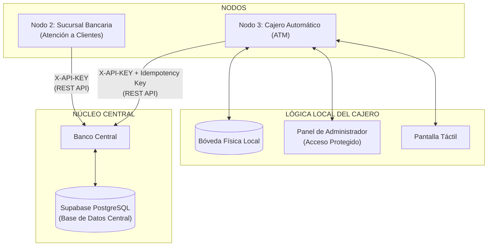
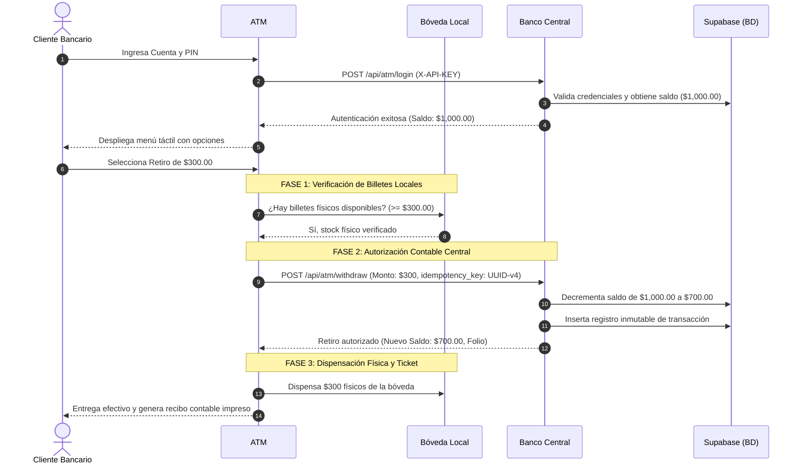
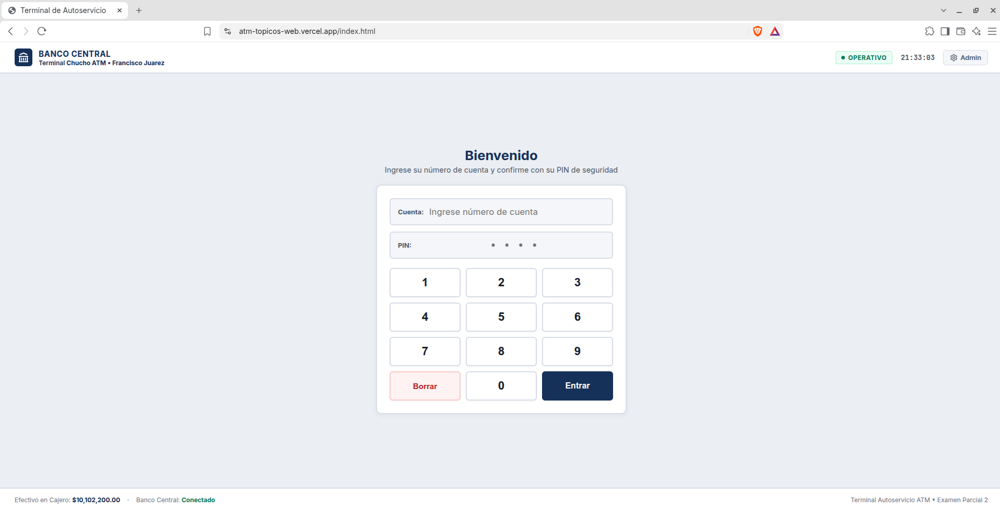
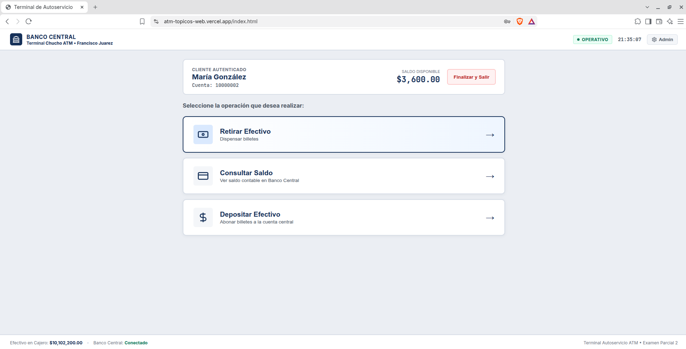
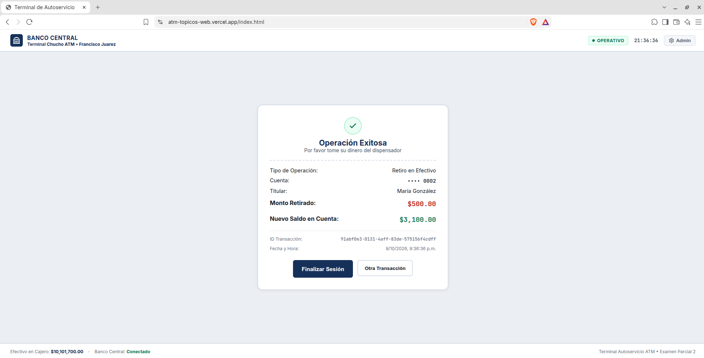
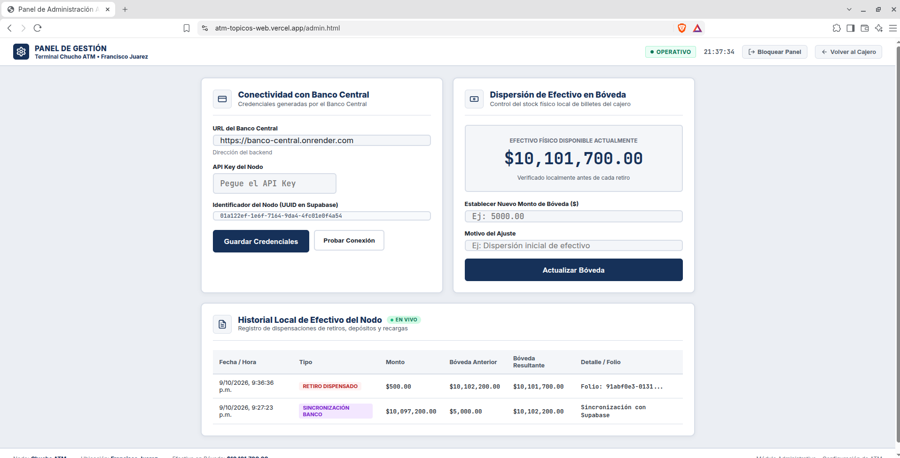

# Nodo 3: Cajero Automático (ATM) - Sistema Bancario Distribuido

[](https://nodejs.org/)
[](https://expressjs.com/)
[](openapi.yaml)
[](https://vercel.com/)

Repositorio del **Nodo 3: Cajero Automático (ATM)** correspondiente al Segundo Examen de **Tópicos Avanzados de Desarrollo Web**.

Este nodo representa una terminal física de autoservicio bancario con pantalla táctil, conectada de manera distribuida al **Banco Central**, encargada de la autenticación de tarjetahabientes, consulta de saldos, depósitos y dispensación física de billetes con control de bóveda local y protección de idempotencia.

---

## Enlaces del Sistema en Producción

A continuación se presentan los enlaces oficiales de despliegue y documentación de los nodos que componen el sistema bancario distribuido:

| Nodo | Rol | Infraestructura | Enlace de Acceso |
| :--- | :--- | :--- | :--- |
| **Nodo 3: Cajero Automático (ATM)** | Terminal de Autoservicio y Bóveda Física | **Vercel** | [https://atm-topicos-web.vercel.app](https://atm-topicos-web.vercel.app) |
| **Nodo 2: Sucursal Bancaria** | Apertura de cuentas y transferencias | **Vercel** | [https://banco-sucursal-five.vercel.app](https://banco-sucursal-five.vercel.app/) |
| **Nodo 1: Banco Central** | Núcleo de Contabilidad y Supabase PostgreSQL | **Render** | [https://banco-central.onrender.com](https://banco-central.onrender.com) |
| **Contrato Formal API** | Especificación técnica OpenAPI 3.0.3 | Repositorio | [`openapi.yaml`](openapi.yaml) |

---

## Arquitectura del Sistema Distribuido

El sistema opera bajo una **red descentralizada en operabilidad pero centralizada en la consolidación de datos**:



* **Banco Central:** Servidor centralizado que orquesta la contabilidad, valida firmas de nodos y persiste todas las transacciones en Supabase.
* **Nodo ATM:** Opera de manera autónoma como un quiosco de autoservicio. Valida el stock físico local antes de pedir autorización central y procesa transacciones de retiro con llaves de idempotencia únicas.

---

## Flujo de Retiro de Efectivo

Para cumplir con la rúbrica de evaluación, el cajero implementa una secuencia de dos fases para retiros en cajeros automáticos:



### Reglas de Negocio Implementadas:

Suponiendo el mismo ejemplo de Retiro de $300.00:

* **Verificación Física Previa:** Si el cajero físico tiene menos de $300 en su bóveda, rechaza la operación de inmediato con código `409 Conflict`, protegiendo al cliente de que se le descuente dinero de su cuenta bancaria sin recibir billetes.

* **Idempotencia:** Se adjunta un UUID único a cada transacción. Si la red falla o se reintenta la petición, el Banco Central detecta la misma clave y no duplica el cobro.

* **Persistencia Local Segura:** En Vercel, la bóveda física y los movimientos locales se preservan en `/tmp/atm_state.json`.

---

## Galería de la Interfaz y Evidencia de Funcionamiento

A continuación se presenta la evidencia visual del quiosco táctil de autoservicio y del panel de supervisión en tiempo real:

| 1. Terminal Táctil (Bienvenida) | 2. Menú de Cliente y Consulta de Saldo |
| :---: | :---: |
|  |  |
| *Identificación táctil y telemetría de red* | *Autenticación central y consulta de balance* |

| 3. Comprobante Digital con Folio UUID | 4. Panel Supervisor y Auditoría en Vivo |
| :---: | :---: |
|  |  |
| *Recibo con clave de idempotencia y nuevo saldo* | *Telemetría de bóveda con actualización cada 3s* |

---

## Proceso de Desarrollo y Construcción

Para construir la solución completa de este nodo bancario, se siguió una metodología de desarrollo modular, desacoplada y orientada a microservicios distribuidos:

### I. Estructura del Proyecto

El código está organizado siguiendo el principio de separación de responsabilidades:

```text
cajero_atm/
├── api/
│   └── index.js                 # Handler serverless para despliegue en Vercel
├── data/
│   └── test_accounts.json       # Datos para pruebas y simulación local
├── docs/
│   └── screenshots/             # Evidencia visual y capturas de funcionamiento
├── public/
│   ├── css/
│   │   └── style.css            # Estilos
│   ├── js/
│   │   ├── admin.js             # Lógica del panel administrativo
│   │   └── atm.js               # Lógica del ATM para el cliente
│   ├── admin.html               # Vista del panel de administración
│   └── index.html               # Vista táctil del cajero de autoservicio
├── src/
│   ├── config/
│   │   └── env.js               # Carga y validación centralizada de variables de entorno
│   ├── controllers/
│   │   ├── adminController.js   # Controlador de supervisor, bóveda y conectividad
│   │   └── atmController.js     # Controlador de operaciones bancarias del cajero
│   ├── routes/
│   │   └── api.js               # Definición y mapeo de rutas REST (/api/*)
│   ├── services/
│   │   ├── bankService.js       # Cliente HTTP hacia Banco Central e idempotencia
│   │   └── cashService.js       # Control físico de bóveda y dispensador local
│   ├── app.js                   # Configuración del servidor Express y middlewares
│   └── server.js                # Inicialización y arranque en entorno local
├── .env.example                 # Plantilla documentada de variables de entorno
├── openapi.yaml                 # Contrato formal OpenAPI 3.0 de la API del cajero
├── package.json                 # Dependencias y scripts de ejecución
└── vercel.json                  # Reglas de reescritura para la nube de Vercel
```

---

### II. Etapas de Construcción

#### Arquitectura Base y Entorno Serverless
* **Configuración del Servidor Express:** Se configuró un servidor ligero utilizando Express con middlewares esenciales (`cors`, `express.json` y `express.urlencoded`).
* **Compatibilidad con Vercel:** Se creó el archivo `vercel.json` con reescrituras hacia `api/index.js`, el cual expone la aplicación Express como una función serverless sin requerir cambios en el código al pasar de local a la nube.
* **Gestión de Entorno Centralizada (`src/config/env.js`):** Se concentró la lectura de variables (`dotenv`) con valores por defecto controlados para asegurar resiliencia en caso de variables no declaradas.

#### Control de Efectivo Físico Local (`src/services/cashService.js`)
* **Lógica Independiente de la Bóveda:** Siguiendo el requerimiento de negocio, el cajero maneja su inventario físico de forma autónoma. Contiene métodos para consultar disponibilidad (`hasEnoughCash`), descontar efectivo entregado (`dispenseCash`), registrar depósitos recibidos (`acceptDeposit`) y permitir ajustes administrativos (`setCashAvailable`).
* **Estrategia de Persistencia Híbrida:** En funciones serverless de Vercel el sistema de archivos es de solo lectura con excepción de `/tmp`. El servicio detecta si se encuentra en Vercel (`process.env.VERCEL`) y utiliza `/tmp/atm_state.json`; en entornos locales usa `data/atm_state.json`.

#### Cliente de Conectividad con Banco Central (`src/services/bankService.js`)
* **Comunicación Segura:** Todas las peticiones salientes incluyen la cabecera institucional `X-API-KEY` y un `User-Agent` que identifica al nodo.
* **Sincronización Dinámica de Nodo (`GET /api/nodes/me`):** El cajero consulta al Banco Central para obtener su nombre registrado (`Chucho ATM`), ubicación (`Francisco Juarez`), UUID de Supabase y efectivo asignado, desacoplando completamente la identidad del nodo de configuraciones estáticas.
* **Manejo de Tiempos de Espera y Cancelación:** Se implementó un timeout de 8 segundos utilizando `AbortController` nativo para evitar bloqueos del cajero si el Banco Central experimenta latencia o caídas.
* **Idempotencia Transaccional:** Se integró la generación de identificadores únicos universales (`crypto.randomUUID()`) enviados en la cabecera `idempotency-key` para prevenir cobros dobles.
* **Mecanismo de Simulación Local (`MOCK_BANK`):** Para permitir pruebas autónomas sin depender de que el servidor central esté encendido, se implementó un conmutador que consulta y actualiza `data/test_accounts.json` cuando `MOCK_BANK=true`.

#### Capa de Controladores y Rutas (`src/controllers/`, `src/routes/api.js`)
* **`AtmController`:** Gestiona el ciclo de vida de las operaciones del cliente: autenticación con cuenta y PIN (`login`), consulta de saldo (`balance`), retiro en dos fases (`withdraw`) y depósito (`deposit`).
* **`AdminController`:** Expone endpoints protegidos para que el operador técnico pueda desbloquear el panel (`login`), consultar y modificar credenciales en caliente (`config`), diagnosticar enlace (`test-connection`) y dotar efectivo a la bóveda (`cash`).

#### Interfaz Táctil de Autoservicio (`public/index.html`, `public/js/atm.js`, `public/css/style.css`)
* **Diseño Tipo Quiosco:** Se diseñó una interfaz táctil con aspecto de cajero automático profesional, fondo blanco institucional, tonos azul bancario y sin emojis.
* **Teclado Numérico Interactivo:** Permite al usuario capturar su número de cuenta y PIN de 4 dígitos mediante botones táctiles en pantalla o el teclado físico.
* **Componentes en Tiempo Real:** Barra superior con reloj digital en vivo, indicador de estado de red (`OPERATIVO`) y metadatos dinámicos del nodo; y barra inferior que refleja el efectivo disponible y el estado del API Key.
* **Flujo Transaccional:** Pantallas transicionales de Bienvenida &rarr; Menú Principal &rarr; Selección de Monto &rarr; Procesamiento &rarr; Impresión de Recibo con folio UUID.

#### Panel Administrativo de Supervisor (`public/admin.html`, `public/js/admin.js`)
* **Modo Mantenimiento Protegido:** Bloqueo inicial que exige contraseña de supervisor antes de revelar la telemetría del nodo.
* **Sesión Efímera:** El estado de autenticación se administra en `sessionStorage` (`atm_supervisor_auth`), permitiendo bloquear el panel manualmente o destruyendo la sesión al cerrar la pestaña.
* **Configuración en Vivo:** Permite probar el enlace con el Banco Central y actualizar la URL o API Key en tiempo real.
* **Auditoría Local:** Visualización tabular con etiquetas de auditoría (`RETIRO DISPENSADO`, `DEPÓSITO RECIBIDO`, `AJUSTE`) y balance resultante de la bóveda.

#### Contrato de Integración OpenAPI 3.0 (`openapi.yaml`)
* Formalización técnica de todos los contratos, parámetros, modelos de datos de entrada y esquemas de respuesta con códigos HTTP de éxito y error (`200`, `400`, `401`, `409`, `422`, `502`).

---

## Panel Administrativo

El ATM incluye un panel de gestión institucional protegido para operadores de mantenimiento (`/admin.html`):

* **Autenticación de Operador:** Requiere contraseña técnica (`ATM_ADMIN_PASSWORD`).
* **Configuración en vivo:** Permite modificar la **URL del Banco Central** y el **API Key** sin necesidad de reiniciar el servidor.
* **Diagnóstico de Red:** Botón "Probar Conexión" que realiza un ping de prueba contra el Banco Central.
* **Control de Bóveda:** Formulario para ajustar el efectivo físico local.
* **Auditoría Local:** Tabla en tiempo real con el historial de dispensaciones, depósitos y recargas.

---

## Simulación Local vs. Producción

El nodo cuenta con un conmutador de simulación mediante la variable de entorno `MOCK_BANK`:

| Modo | Variable | Comportamiento |
| :--- | :--- | :--- |
| **Pruebas Locales** | `MOCK_BANK=true` | Utiliza `data/test_accounts.json` como simulador central. Permite probar retiros, depósitos y consultas de saldo de forma autónoma. |
| **Producción** | `MOCK_BANK=false` | Realiza llamadas HTTP autenticadas contra la API real de Laravel usando cabeceras `X-API-KEY`. |

---

## Especificación de Contrato API (OpenAPI 3.0)

La especificación OpenAPI formal completa está disponible en el archivo [`openapi.yaml`](openapi.yaml).

### Resumen de Endpoints:

| Método | Endpoint | Descripción | Acceso |
| :--- | :--- | :--- | :--- |
| `GET` | `/api/health` | Healthcheck y estado de configuración | Público |
| `GET` | `/api/atm/status` | Telemetría del nodo, ubicación y efectivo local | Público |
| `POST` | `/api/atm/login` | Validación de tarjetahabiente (Cuenta + PIN) | Cliente |
| `GET` | `/api/atm/balance/:accountNumber` | Consulta de saldo en Banco Central | Cliente |
| `POST` | `/api/atm/withdraw` | Retiro con verificación local e idempotencia | Cliente |
| `POST` | `/api/atm/deposit` | Depósito y abono a cuenta central | Cliente |
| `POST` | `/api/admin/login` | Acceso a modo supervisor | Administrador |
| `GET` | `/api/admin/config` | Consulta de configuración y auditoría | Administrador |
| `POST` | `/api/admin/config` | Actualización de API Key y URL del Core | Administrador |
| `POST` | `/api/admin/cash` | Dotación / ajuste de bóveda física | Administrador |
| `GET` | `/api/admin/test-connection` | Diagnóstico de enlace con Banco Central | Administrador |

---

## Variables de Entorno

Crea un archivo `.env` en la raíz basándote en `.env.example`:

```ini
PORT=3000
CENTRAL_BANK_URL=https://banco-central.onrender.com
ATM_API_KEY=tu_api_key_aqui
INITIAL_LOCAL_CASH=100000.00
ATM_NODE_NAME=Chucho ATM
ATM_LOCATION=Francisco Juarez
ATM_NODE_ID=01a122ef-1e6f-7164-9da4-4fc01e0f4a54
MOCK_BANK=false
ATM_ADMIN_PASSWORD=admin1234
```

---

## Despliegue en Vercel

1. Sube tu repositorio a GitHub.
2. Inicia sesión en [Vercel](https://vercel.com/) y haz clic en **"Add New..." > "Project"**.
3. Importa el repositorio `atm-topicos-web`.
4. En **Environment Variables**, configura las variables del `.env`.
5. Haz clic en **"Deploy"**.

Vercel compilará automáticamente el proyecto utilizando `api/index.js` como función serverless y servirá la carpeta `public/` como assets estáticos.

---

## Credenciales de Acceso

Para probar dentro de la web con datos reales, se pueden usar las siguientes:

Cuenta: 10009003
PIN: 1234

Contraseña Admin: admin1234